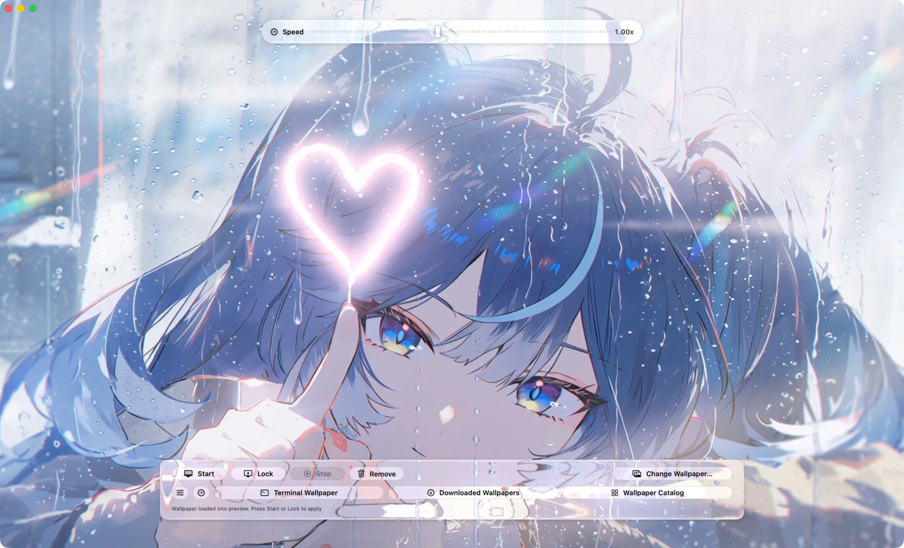

<p align="center">
  
</p>

<h1 align="center">AuraFlow</h1>

<p align="center">
  Native live wallpapers for the macOS Desktop and Lock Screen.
</p>

<p align="center">
  <a href="https://github.com/mkanami/AuraFlow/actions/workflows/tests.yml"></a>
  <a href="https://github.com/mkanami/AuraFlow/releases"></a>
  
  
  <a href="LICENSE"></a>
</p>

<p align="center">
  Use your own video, animation, image, or terminal program — or download a
  wallpaper from the built-in catalog.
</p>

<p align="center">
  
</p>

## Highlights

<table>
  <tbody>
    <tr><td><strong>Desktop playback</strong></td><td>Loop animated wallpapers behind desktop icons across connected displays.</td></tr>
    <tr><td><strong>Lock Screen</strong></td><td>Show the active wallpaper on the Lock Screen, with a Lock Screen-only mode for local media.</td></tr>
    <tr><td><strong>Wallpaper Catalog</strong></td><td>Browse, preview, download with progress and cancellation, and reopen wallpapers without leaving the app.</td></tr>
    <tr><td><strong>Local media</strong></td><td>Open videos, GIFs, WebM files, and still images from your Mac.</td></tr>
    <tr><td><strong>Terminal wallpapers</strong></td><td>Run CLI animations, static compositions, and terminal dashboards as wallpapers.</td></tr>
    <tr><td><strong>Playback controls</strong></td><td>Change speed, pause, resume, and automatically pause for fullscreen apps.</td></tr>
    <tr><td><strong>Scaling</strong></td><td>Use one Fill / Fit / Stretch control for the installed media or terminal wallpaper.</td></tr>
    <tr><td><strong>Launch at login</strong></td><td>Restore your selected wallpaper automatically when you sign in.</td></tr>
    <tr><td><strong>Safe removal</strong></td><td>Stop AuraFlow and restore the previous macOS wallpaper with one action.</td></tr>
  </tbody>
</table>

## Installation

1. Download the latest [`AuraFlow.dmg`](https://github.com/mkanami/AuraFlow/releases/latest).
2. Open the disk image and drag **AuraFlow** into **Applications**.
3. Launch AuraFlow from Applications.

No account is required. The online catalog, CLI package metadata, and package
installation need an internet connection. Local media and installed terminal
programs can run offline.

## Getting Started

1. Select **Change Wallpaper…** to open a local file, or choose a wallpaper in
   **Wallpaper Catalog**. For CLI animations and dashboards, open **Terminal Wallpaper**.
2. Check the wallpaper in the main preview.
3. Select **Start** for Desktop playback. **Play AuraFlow on Lock Screen** in
   Playback Settings also enables Lock Screen playback. For local media, **Lock**
   starts Lock Screen-only mode.
4. Use **Remove** to stop AuraFlow and restore the previous wallpaper.

### Main controls

| Control | Action |
| --- | --- |
| **Start** | Apply the selected wallpaper to the Desktop, and to the Lock Screen when enabled. |
| **Lock** | Apply selected local media only to the Lock Screen. |
| **Stop / Play** | Pause or resume an animated wallpaper. |
| **Remove** | Stop AuraFlow and restore the previous macOS wallpaper. |
| **Change Wallpaper…** | Select media stored on this Mac. |
| **Terminal Wallpaper** | Find, install, and preview terminal programs or enter a custom command. |
| **Wallpaper Catalog** | Browse online wallpapers. |
| **Downloaded Wallpapers** | Reopen previously downloaded wallpapers. |
| **Monitoring** | View playback state and resource usage. |

Still images do not show Stop or Play. Remove the active AuraFlow wallpaper
before switching between Desktop and Lock Screen-only modes.

**Playback Settings** contains the shared **Scale Algorithm** and **Launch AuraFlow
at login** controls. Scale immediately updates the installed media or terminal
wallpaper, even when a different source is selected in the preview. Without an
installed wallpaper, it updates the selected preview. The default is **Fill**;
Lock Screen playback is enabled by default. Scale is unavailable for web projects.

## Wallpaper Catalog

The catalog uses lightweight media for previews and downloads the original file
only after you select **Download**. Saved files appear under **Downloaded
Wallpapers** and are reused on the next launch. Downloads show progress and can
be cancelled without changing the current wallpaper.

Foreground downloads take priority over preview traffic. The active card pauses
its preview while the original file is transferred, then resumes without
affecting a wallpaper already running on the Desktop.

## Compatibility

### Terminal wallpapers

Open **Terminal Wallpaper** to search installed commands and Homebrew packages,
or add a custom command. Presets include Asciiquarium, lavat, CMatrix, pipes,
cbonsai, and Nyan Cat, with both animated and static bonsai modes. Programs are
installed on demand; Homebrew is needed to install packages, not to run commands
already available on your Mac.

Previewing a command does not replace the installed wallpaper. Use **Start** to
apply it and **Stop / Play** to pause or resume an animation. Static commands keep
their completed frame. Changing Scale does not restart the CLI. Font, background,
and frame rate remain under **Appearance & performance**; **Apply settings**
applies those settings.

Search is not limited to the presets, so compatibility depends on the selected
program. Commands requiring files, stdin, authentication, or interactive setup
may not work as wallpapers. If a command fails, AuraFlow keeps the previous
preview and asks you to choose another program. Terminal wallpapers are visual
only and do not play audio. Lock Screen playback follows the shared setting;
terminal wallpapers do not have a separate Lock Screen-only mode.

### Local Wallpaper Engine projects

Open **Downloaded Wallpapers**, switch the library above its heading to
**Wallpaper Engine**, and choose **Import Wallpaper Engine…**. Import accepts
the wallpaper video or HTML entry file, an unpacked project folder, `project.json`, or a Workshop `431960` folder with
projects in its immediate subfolders. You can also drop a project onto AuraFlow
or use the import action in Wallpaper Catalog or the menu-bar Change Wallpaper
menu. No Steam account or Workshop downloads are involved.
When selecting a video or HTML file, AuraFlow automatically reads the nearest
enclosing `project.json` and checks that the selected file is its declared entry.
Scene projects with MP4 assets are still unsupported. Standalone videos without
Wallpaper Engine metadata use the existing **Choose video or image…** action.
The import picker opens in Steam's local Wallpaper Engine Workshop folder when
available, including additional libraries from `libraryfolders.vdf`. Otherwise it
checks authored projects, the last import folder, then the local Steam library;
you can always navigate to a different folder manually.

Video projects use AuraFlow's existing media pipeline. Web projects use WebKit
for HTML/CSS/JavaScript, Canvas and WebGL, with project property controls. Import
and Preview do not apply wallpapers: use **Start**, and use **Remove** before
switching between video, terminal and web runtimes. Imported copies and property
values are stored separately from the original project. Identical imports are
deduplicated; edited projects become separate versions.

Web compatibility is intentionally limited: local assets only, no external
network, downloads, system permissions, audio reaction, music metadata, RGB or
file/directory property selectors. Workers are disabled because worker contexts
cannot receive the offline sandbox's WebKit user scripts. Hidden preview and
fullscreen-paused web content is unloaded and restored with its property values.
The desktop helper survives closing AuraFlow. Web Lock Screen integration uses
a **static snapshot**, not a second animated browser; missing or black snapshots
are reported as errors. Scene, application and ZIP imports are unsupported.

## Platform compatibility

| Environment | Desktop | Lock Screen |
| --- | --- | --- |
| macOS 26 or newer | Animated playback | Native animated playback |
| macOS 13–15 | Animated playback | Included screen saver integration |
| Apple Silicon | Supported | Supported |
| Intel Mac | Supported | Supported |

Native Lock Screen integration depends on APIs available in macOS 26. AuraFlow
keeps the older screen saver path for earlier supported releases.

## Architecture

AuraFlow is a Swift Package split into small runtime components:

| Component | Responsibility |
| --- | --- |
| `WallpaperControlApp` | SwiftUI interface, previews, catalog, downloads, and user actions. |
| `AuraWallpaperAgent` | Long-running wallpaper playback and lifecycle coordination. |
| `AuraWallpaperCore` | Shared models, persistence, recovery, and platform operations. |
| `AuraWallpaperNativeBridge` | Isolated macOS 26 native wallpaper integration. |
| `AuraTerminalWallpaperCore` | Terminal configurations, CLI discovery, installation, and runtime state. |
| `AuraTerminalRendering` | Terminal parsing, composition, and CoreText / Metal rendering. |
| `AuraTerminalWallpaperAgent` | Independent CLI playback and shared Desktop / Lock Screen frames. |
| `AuraWallpaperEngineCore` | Validated local imports, project properties and isolated WebKit rendering. |
| `AuraWebWallpaperAgent` | Independent desktop web playback and static Lock Screen snapshots. |
| `AuraFlowLockScreenSaver` | Lock Screen fallback for earlier macOS versions. |

Media playback uses AVFoundation; terminal programs run through a PTY and render
with CoreText and Metal. AppKit bridges are limited to macOS window and wallpaper
behavior that SwiftUI does not expose directly. Normal playback does not require
FFmpeg. The v1.3.2 download uses locally installed FFmpeg tools for optional video
preprocessing, including Blend Interpolation and conversions that require FFmpeg.
Video Optimization settings apply to newly imported local videos, not terminal
programs or an already installed wallpaper.

## Build and Test

Requirements:

- Xcode with the macOS SDK
- Swift 5.9 or newer
- macOS 13 or newer
- FFmpeg (`ffmpeg` and `ffprobe`) for video preprocessing tests

Run the test suite:

```sh
DEVELOPER_DIR=/Applications/Xcode.app/Contents/Developer \
  ./scripts/test_macos_app.sh
```

Real WebKit integration tests require an unlocked interactive macOS session.
They validate Canvas/WebGL snapshots and property/network behavior without
changing the system wallpaper or Screen Saver:

```sh
AURAFLOW_WEBKIT_TESTS=1 DEVELOPER_DIR=/Applications/Xcode.app/Contents/Developer \
  swift test --package-path macOSApp --filter WebWallpaperIntegrationTests
```

Create a universal `arm64 + x86_64` release:

```sh
FFMPEG_RUNTIME_BUNDLING=0 BUILD_UNIVERSAL=1 REQUIRE_UNIVERSAL=1 scripts/build_release.sh
```

Artifacts are written to `dist/` by default. Set
`AURAFLOW_OUTPUT_DIR` to choose a different destination. See
[Releasing](docs/releasing.md) for signing, archive validation, and optional
bundling of portable FFmpeg tools.

## Repository Layout

```text
macOSApp/                   Swift package, app, agents, bridges, and tests
scripts/build_release.sh   Universal release, signing, ZIP, and DMG pipeline
scripts/test_macos_app.sh  Core and UI test suites in separate test hosts
script/build_and_run.sh    Local debug build and launch helper
docs/                      README media and release documentation
```

## Troubleshooting

- If **Start** or **Lock** is unavailable, remove the currently active AuraFlow
  wallpaper first.
- If a catalog download was interrupted, reopen the card and download it again.
- Open **Monitoring** when playback is not running as expected.
- Keep enough free storage for the original wallpaper and temporary media
  processing.

When filing an issue, include the macOS version, Mac model, wallpaper format,
and the action that triggered the problem.

## Contributing

Bug reports and focused pull requests are welcome. Keep platform changes scoped,
add regression coverage where practical, and run the test suite before opening
a pull request.

## License

AuraFlow is available under the [MIT License](LICENSE).
